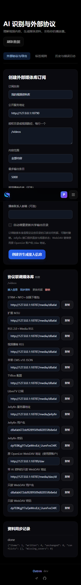

# OStrm AI：OpenList 视频识别、媒体资料与订阅服务

基于 [hienao/ostrm](https://github.com/hienao/ostrm) 的 Fork，为 OpenList 挂载的视频生成可供外部媒体库使用的资料。使用在线 MiniCPM-V 4.7 理解真实视频内容，生成中文简介、标签、人物与事件观察及视频帧封面，再通过 STRM/NFO、M3U、RSS、TVBox、WebDAV 和 Jellyfin API 交给客户端浏览与播放。

**本项目不提供视频播放器。** 视频仍保存在 OpenList 挂载的存储中；你使用 Kodi、Jellyfin、Infuse、TVBox 等客户端观看。AI 服务负责生成和维护媒体资料，播放请求解析当前有效的 OpenList 地址后重定向，不代理或转码播放流。

**Docker 和本地推理都不是必需条件。** 可在普通 Linux 主机、NAS 或 FreeBSD/Serv00 原生运行，通过网络调用模型 API；可选兼容的自托管推理服务。

当前功能开发分支为 **dev**，下面按该分支安装。发布顺序为 `dev → beta → main`；不要将上游历史版本或默认 `latest` 镜像等同于包含全部 AI 功能的当前源码。原项目说明保存在 [UPSTREAM_README.md](docs/UPSTREAM_README.md)。

快速入口：[功能与协议](#功能) · [Docker 安装](#安装完整-ostrm-ai) · [识别与播放器接入](#使用识别并导入播放器) · [原生安装](#没有-docker--serv00-等受限主机) · [升级与备份](#升级备份与卸载) · [常见问题](#常见问题)

## 从视频到播放器

```text
已有 OpenList 挂载 → 扫描发现 / OStrm STRM 任务 → 持久化识别队列
  → FFmpeg 整片压缩 + 可选字幕证据 → 在线 MiniCPM-V 4.7
  → 中文简介 / 标签 / 人物与事件 / 视频帧封面
  → 受限目录订阅 / 资料导出 → Kodi、Jellyfin、Infuse、TVBox、LibreTV 等
```

模型识别以视频画面和可选字幕为依据，不是仅按文件名猜测，也不等同于电影资料网站的权威演职员档案。年份会使用文件名中的明确年份；已有 NFO 的片名、演员等正式资料与 AI 观察分别处理。长片压缩会损失细节，片名、人物关系和剧情仍可能出错，支持人工校对标签和重新识别。

## 功能

- 在线 MiniCPM-V 4.7 1B / 35B-A3B；兼容的自托管推理服务也可使用。支持 Docker 或 FreeBSD 原生运行，**不安装本地模型、不要求 GPU**。
- 读取真实视频，将完整时间轴压缩为 MP4 后发送给模型；支持字幕证据、受限的补充证据帧、缓存与重新识别。不是只看文件名生成标签。
- 中文摘要、内容标签、画面文字、人物和关系观察。AI 推测人物不冒充真实演员署名；文件名年份有明确来源。
- 持久化扫描、暂停/恢复/取消/重试、重启恢复；人工标签与 AI 标签分开保存。
- 保留 OStrm 原有任务；可选新 STRM 自动加入 AI 队列，识别后将 NFO、海报与 JSON 写入共享输出目录。
- 按目录、标签、成人/非成人范围创建独立媒体订阅；可以撤销和轮换凭据。
- SQLite 开箱即用；支持独立 TiDB 库，模型密钥不进入媒体文件和播放器配置。
- 管理端可搜索文件名、简介和标签，分页查看资料，管理同义标签、常用标签、识别历史与错误日志。
- 封面优先复用识别时生成的画面，并独立恢复到私有缓存，不等待网盘上传；已有视频可后台补图，优先复用可访问的网盘缩略图。目录可写时保存同目录封面，不可写时仍能显示私有缓存。失败会冷却后重试，无须重新识别。

### 整片识别如何工作

默认将**完整时间轴**压缩成 H.264 MP4，一次作为视频输入发送给模型，而非只提交几张截图。插件当前压缩文件上限为 **23 MiB**，这是插件的上传预算，不代表所有模型供应商都承诺接受同样大小的请求；base64 请求体还会增大约三分之一。压缩会降低分辨率和帧率并去掉音轨，模型服务也可能再次采样视频帧，因此不能保证逐帧理解或听懂原片对白。

启用「结合字幕识别」可提取内嵌文本字幕，或在环境支持时 OCR 画面字幕，并结合有限的补充证据帧进行校核。压缩视频与字幕证据支持缓存复用。远程大文件仍需读取源视频，受单片流量、原片大小、工作目录空间和超时限制；超过预算会报错，不会无限制下载或占用资源。

### 输出协议与适用客户端

| 输出/接口 | 用途 | 当前实现 |
|---|---|---|
| STRM + Kodi NFO + JPG + AI JSON | Kodi/Jellyfin 本地扫描 | ZIP 下载、持久化导出队列、增量同步；可附已有字幕 |
| 扩展 M3U | 通用播放列表/IPTV | 标题、时长、分组、封面、动态播放地址 |
| RSS 2.0 + Media RSS | 视频订阅 | enclosure、中文简介、关键词、分类、封面 |
| 视频播客 RSS | 播客客户端 | iTunes 作者/邮箱/显式内容/封面字段；仅 MP4/M4V/MOV |
| 苹果 CMS v10 JSON + TVBox | 国内聚合客户端 | 分类、搜索、分页、详情、播放地址；不宣称完整 CMS 后台 |
| LibreTV v2 订阅 | 聚合前端 | VOD 源和 M3U 源配置 |
| WebDAV | Infuse/Kodi 网络目录 | 复用 OpenList `/dav`；另有附 AI NFO/海报的只读虚拟目录 |
| Jellyfin 10.11 API 兼容层 | 账户登录、浏览、直放、观看进度 | 支持核心 SDK 路径；不含完整 Jellyfin 服务端或转码 |

**兼容性边界：** SDK/接口测试通过不等于所有品牌客户端都经过实机测试。Infuse、Apple Podcasts、TVBox 物理设备仍需按实际版本验证；不支持客户端要求的服务器转码。LibreTV 默认限制私网源，应使用客户端可访问的公网 HTTPS 地址。播客平台是否收录还取决于媒体编码、公网访问和平台审核要求。

## 实际界面

以下来自自动化测试启动的真实 Nuxt + Java + Python 服务，使用合成视频与固定模型响应，不作为模型准确率展示。截图中的地址和凭据仅用于本地测试。


<details><summary>移动端界面</summary>



</details>

## 安装：完整 OStrm AI

### 选择安装方式

| 方式 | 适用环境 | 入口与要求 |
|---|---|---|
| Docker Compose 完整版 | Linux NAS/VPS，方便统一构建部署 | OStrm 管理端 + Java 后端 + Python AI 服务；按下文安装 |
| FreeBSD 原生完整版 | Serv00 等无 Docker/root 环境 | Java 21、Python ≥ 3.11、nginx、FFmpeg/FFprobe；见 [原生安装教程](docs/FREEBSD_NATIVE.md) |
| Python 伴随模式 | 只需识别、协议及 OpenList 页面接入 | Python ≥ 3.11、FFmpeg/FFprobe、反向代理；见下文「没有 Docker」 |

共同前提：已有可正常读取视频的 OpenList、从部署主机可连接的模型服务及对应区域密钥、客户端可访问的服务地址。使用在线模型时，识别主机需要 CPU 做视频压缩，无需 GPU。可选 LibreTV 单独部署，不随 Compose 自动安装。

### 1. 获取源码和配置

FreeBSD / Serv00 无 Docker 环境见 [原生安装、同域名路由与旧插件迁移](docs/FREEBSD_NATIVE.md)。完整 Java + Nuxt + Python 应用可以放在现有 OpenList 同域名的 `/ostrm/`，旧 `/media/` 订阅链接可保持不变。

需要网页影院时，可选用[原版 LibreTV 接入](integrations/libretv/README.md)，直接接入本项目的成人/非成人 CMS 源。影院作为独立进程运行，AI 服务继续专注识别与媒体资料。

适合 Linux NAS/VPS，安装 Docker Engine 与 Compose 插件即可。先有一个能够正常访问视频的 OpenList。

```bash
git clone --branch dev https://github.com/imHansiy/ostrm-ai.git
cd ostrm-ai
cp .env.ai.example .env
```

编辑 `.env`，至少设置以下项目。示例域名和密钥均需替换：

```dotenv
OPENLIST_URL=http://你的OpenList:5244
PUBLIC_OPENLIST_URL=https://你的OpenList域名
OPENLIST_USERNAME=admin
OPENLIST_PASSWORD=你的OpenList管理密码
MODEL_BASE_URL=https://api.modelbest.ai/v1
MODEL_NAME=MiniCPM-V-4.7-35B-A3B
MODEL_API_KEY=你的对应区域模型密钥
JWT_SECRET=替换为至少32字节随机值
AI_BRIDGE_KEY=另一个独立随机值
MEDIA_PUBLIC_BASE_URL=https://你的OStrm-AI域名
AI_AUTO_ENQUEUE=false
```

可以使用 `openssl rand -hex 32` 分别生成两个随机值。国内密钥使用对应的国内端点；先确认部署主机能连接该区域服务。模型规格和地址也可以在 UI 中修改；模型密钥是只写字段。

| 配置 | 填写说明 |
|---|---|
| `OPENLIST_URL` | AI 服务访问 OpenList 的后端地址，不是本项目自身地址 |
| `PUBLIC_OPENLIST_URL` | 播放器可访问的 OpenList 地址，用于原 OpenList WebDAV 链接 |
| `OPENLIST_USERNAME` / `OPENLIST_PASSWORD` | 服务端访问 OpenList 的管理账户；也可配置 `OPENLIST_TOKEN` |
| `MODEL_BASE_URL` / `MODEL_NAME` / `MODEL_API_KEY` | API 根地址、模型名称、该区域密钥；`MODEL_PROXY_URL` 为可选模型请求代理 |
| `JWT_SECRET` / `AI_BRIDGE_KEY` | 两个独立随机值，分别用于管理登录和 Java→AI 服务桥接 |
| `MEDIA_PUBLIC_BASE_URL` | 客户端可访问的 OStrm AI 公共服务地址，例如 `https://media.example.com`，不是 OpenList 文件路径或 `/ai` 管理页 |
| `MEDIA_ALLOWED_HOSTS` | 实际网盘/CDN 的主机白名单；OpenList 自身源自动允许，其他重定向目标也需符合限制 |
| `MEDIA_PROXY_URL` / `MEDIA_PROXY_HOSTS` | 可选媒体代理及逗号分隔的匹配主机，例如 `dl1.aliyundrive.cloud`。仅匹配来源使用代理，模型与其他来源保持原连接方式；主机白名单、流量预算、超时和 TLS 验证继续生效。代理凭据只放服务端环境变量 |
| `MEDIA_DIRECT_DRIVERS` | 可选，例如 `Quark,UC`。仅识别工作进程通过 OpenList 管理员接口取得真实下载地址与驱动请求头，适用于 OpenList 视频代理不可用的情况。需将真实 CDN 加入媒体白名单；敏感请求头不写入识别结果，也不跨来源重定向转发 |
| `VIDEO_PROBE_TIMEOUT` | 元数据探测时限，默认 90 秒；独立于整片压缩与识别的 `media_timeout`，防止读取时长阶段长时间占住队列 |
| `MEDIA_SMALL_CACHE_BYTES` | 阿里回调下载的小文件临时缓存上限，默认 33554432（32 MiB），设为 0 关闭。已知大小且在流量预算内的视频只完整下载一次，再从临时文件探测、压缩；任务结束自动删除。大文件继续流式读取，压缩与模型参数不变 |
| `AI_AUTO_ENQUEUE` | 是否将 OStrm 新生成 STRM 的视频自动登记并加入 AI 队列；默认关闭 |

配置文件只保存在服务器，不提交 Git。部署后在页面保存的模型设置和密钥会持久化；已配置过的实例优先从管理页修改，不要只改 `.env` 后就假定已有设置也被覆盖。

容器中的 `localhost` 指向容器自身。OpenList 在宿主机时，请使用可路由地址或配置 Docker 的 host-gateway；不要将 `OPENLIST_URL` 填为客户端专用的不可达地址。

### 2. 启动并完成首次登录

```bash
docker compose -f compose.ai.yml up -d --build
docker compose -f compose.ai.yml logs --tail=100 app ai
```

打开 `http://服务器:3111`，首次创建 OStrm 管理账户，然后进入顶部 **AI 识别与协议**。请在首次启动时立即完成注册；对外开放前配置 HTTPS。完整构建需要下载 Java/Node/Python 依赖，初次构建较慢。

AI 容器不暴露独立公网端口；OStrm 使用 JWT 登录并经服务器桥接访问 AI 管理接口。`AI_BRIDGE_KEY` 只配置在服务端。反向代理将整个 OStrm 域名转发至 3111，保留 `/api/`、`/media/`、Authorization、Range、HEAD、PROPFIND。

在 OStrm「OpenList 配置」添加来源地址和服务端 Token，再创建原有 STRM 任务；AI 服务本身的 OpenList 连接通过上面的环境变量配置。当前 AI 服务绑定一个 OpenList 实例，两处来源应保持一致。仅设置 Java 来源不会自动补齐 Python 的 OpenList 认证配置。

### 3. 持久化目录与数据库

默认输出/数据目录：

| 宿主机 | 内容 |
|---|---|
| `data/config`、`data/db`、`logs` | OStrm 配置、数据库和日志 |
| `data/ai` | AI SQLite、密钥、证据缓存、字幕、封面缓存 |
| `strm` | OStrm STRM、AI NFO、海报及订阅同步目录 |

启用 `AI_AUTO_ENQUEUE=true` 后，OStrm 文件处理流水线会登记视频并入队。Java 与 AI 容器必须共享同一个 STRM 输出卷，Compose 已配置。当前一个 AI 服务对应一个 OpenList 实例；来源不匹配会拒绝写入。

默认 AI 结果、人工标签、扫描队列、订阅和观看状态保存在 `data/ai/aitags.sqlite3`；OStrm 自身配置/数据库位于独立目录。**不会把插件表写进 OpenList 自身的数据库。** 如需共用一个 TiDB 实例，给插件使用独立的 `openlist_ai` 库：

```dotenv
AI_DB_BACKEND=tidb
AI_TIDB_HOST=your-cluster.example.com
AI_TIDB_PORT=4000
AI_TIDB_USER=your-plugin-user
AI_TIDB_PASSWORD=your-plugin-password
AI_TIDB_DATABASE=openlist_ai
```

账号需具备该库的建表权限，TLS 校验保持开启。数据库初始化、从 SQLite 迁移和逐表数量校验见 [TiDB 与备份](docs/AI_PROTOCOLS.md#tidb-与备份)。即使用 TiDB，密钥文件、字幕、封面和证据缓存仍需持久保存 `data/ai`，不能把它视为可随意丢弃的缓存目录。

## 使用：识别并导入播放器

1. 在「模型与扫描」填写模型地址和规格、扫描目录、排除目录、并发和网络/压缩超时。保存密钥，执行连接测试。默认识别并发为 1。
2. 在「识别任务」扫描小目录。按需开启字幕证据；先检查一两个视频的真实结果，再扫描整个挂载。
3. 在「识别资料」搜索简介/标签、查看结果、人工修改标签，或者重新识别。修改不会重命名或更改原视频。
4. 在「外部协议与导出」创建订阅。公开服务地址填写**播放器能连接到的 OStrm AI 地址**；授权目录可精确到单个视频。成人/非成人分类依赖已有识别标签，不是独立的人工审核结论。
5. 复制所需协议链接。播放时服务重新解析网盘地址，避免把一次性直链写死在 STRM 中。不要将管理员 Token 或模型密钥填写给播放器。

扫描路径使用 **OpenList 虚拟路径**，例如 `/网盘/OneDrive/Movies`，不是服务器磁盘目录。手动扫描只处理所选目录；需要自动发现新文件时，将目录加入「模型与扫描」的扫描目录，并把自动扫描间隔设为大于 0。`0` 表示关闭定时扫描；这与 OStrm 流水线的 `AI_AUTO_ENQUEUE` 是两个入口。

队列支持暂停、恢复、取消和失败重试；重启后恢复未完成任务。增量扫描跳过未变化且已完成的视频，人工标签在重新识别后保留。建议先并发 1、小目录验证，再按模型额度和服务器资源扩大范围。

历史失败可使用独立的定向恢复批次，默认每批 3 条：批次状态和游标保存在数据库，重启后继续，不等待新增视频全部处理完，也不重置原扫描进度。恢复只选择当前仍失败、没有活动任务的视频，并遵守排除目录；成功记录会跳过。定向批次结束后继续原队列。

服务器端在已有运行中或暂停的恢复计划上，可执行 `python -m aitags.recovery prioritize --task-ids 123 456 789 --priority-batch-size 3`，任务号替换为实际失败任务。一次最多指定 200 条；`status` 查看定向批次游标和状态，`pause` / `resume` / `stop` 仍控制同一恢复计划。

### 创建订阅：先确定给播放器开放什么

在「外部协议与导出」中填写：

1. **订阅名称**：如「我的电影」。
2. **公开服务地址**：播放器能访问且已反代 `/media/` 的地址。FreeBSD 同域名方案使用域名根地址，不是 `/ostrm/` 管理前缀。
3. **授权目录或视频路径**：每行一个 OpenList 路径，可限制到单个视频。
4. **内容范围**：全部、非成人或成人。分区依据识别标签，可能误判；可先校对结果。
5. **最多输出条目**：默认 5000，上限 50000；超出上限时，按最新收录顺序截取，较旧条目不会进入该订阅。
6. 需要在共享目录落地 STRM/NFO 时，勾选自动增量更新，或创建后点击「同步资料」。

创建后点击「接入信息」，按下表复制链接或专属账户。每个订阅都是对所选范围的主动授权，持有链接的人可以读取其中资料并请求播放；保密这些链接，需要失效时使用「更换凭据」或「撤销」。播放器不使用 OpenList 管理密码或模型密钥。

| 接入信息字段 | 应填写到哪里 |
|---|---|
| STRM＋NFO＋封面下载包 | 浏览器下载后解压到 Kodi/Jellyfin 媒体目录 |
| 扩展 M3U | 播放列表 / IPTV 网络列表地址 |
| RSS 2.0＋Media RSS / 视频播客 RSS | RSS 阅读器 / 支持视频播客的客户端订阅地址 |
| 苹果 CMS v10 JSON | 客户端「自定义源」的 API 地址 |
| TVBox 配置 / 成人与非成人分源配置 | TVBox 系客户端的配置地址，不是搜索框或单视频地址 |
| LibreTV 订阅 | 支持该 v2 格式的订阅导入入口；也可直接添加 CMS API |
| 带 AI 资料的只读 WebDAV 地址、用户名、密码 | Infuse/Kodi 等的 WebDAV 网络共享 |
| Jellyfin 服务器地址、用户名、密码 | 支持自定义地址的 Jellyfin 客户端登录界面 |

### Kodi / 真正的 Jellyfin 服务端

下载 STRM/NFO/封面 ZIP，解压到媒体库目录；或者点击「同步资料」，将共享 `strm/<订阅ID>/` 挂载给媒体服务器。开启自动同步后，每分钟检查更新。NFO 的简介和内容标签来自 AI，既有外部 NFO 的标题、演员和原简介会保留，AI 内容附加保存。被手工更改的受管理文件会报告冲突，不盲目覆盖。

在 Kodi 添加影片源并选择本地资料；Jellyfin 添加电影媒体库，启用本地 NFO/图片读取后扫描。`SxxExx` 命名会输出剧集 NFO，但不会自动猜测整季结构或合并多集为虚构剧目。AI 结构化人物关系保存在 `.ai.json`，不会当作真人演员写进 NFO。

典型资料包含 `.strm`、`.nfo`、`-poster.jpg` 和 `.ai.json`，有可用字幕时可附带字幕；不包含原始视频。电影资料优先使用本地文件，避免客户端在线刮削器覆盖已有 AI 简介。媒体服务器和最终播放设备都需能访问订阅中的服务地址以及 OpenList 返回的实际媒体地址；`.strm` 本身不会解决网络不可达或编码不支持的问题。

### M3U / RSS / TVBox / LibreTV

把各自链接填入客户端的播放列表/订阅/配置地址。TVBox 配置提供 type=1 CMS 源；「成人 / 非成人分源」链接会在同一配置中生成两个独立来源，分类、搜索和详情均按内容类型过滤。CMS 支持 `ac`、`wd`、`t`、`pg`、`ids`、`limit`。不支持的复杂筛选不向客户端宣称可用。

**TVBox 分源**：创建内容范围为「全部」的订阅，复制「TVBox 配置（成人 / 非成人分源）」到客户端的配置地址，刷新后选择对应来源。若原订阅已经限定成人或非成人，该配置只输出其允许的单一范围，不会扩大授权。需要完全独立的分享链接时，分别创建成人和非成人两个订阅。

**LibreTV**：使用「设置 → 源管理」添加订阅生成的 CMS 地址；接入两组独立范围时创建两个订阅并分别添加。可选的 [LibreTV 集成教程](integrations/libretv/README.md) 提供固定上游版本与补丁，保留原版首页和播放器，新增「我的网盘」分页海报页，支持关键词、类型、年份、排序和成人/非成人切换。它是独立进程，不是 AI 项目自带播放器；原版 LibreTV 的成人内容过滤也会影响来源显示。补丁部署需同时遵守 LibreTV 的 AGPL 许可并提供对应完整源码。

**M3U / RSS**：在客户端添加网络播放列表或订阅链接；标题、分组、封面等扩展字段能否展示取决于客户端。M3U/RSS 不是包含影片文件的离线下载包。

播客订阅需要填写作者和联系人邮箱，并先生成封面；封面输出 1400×1400。原视频需要客户端支持的编码，源站需要支持 HEAD、Range 和公网访问；应用不会为了播放器转码原视频。

### WebDAV / Infuse

两种选择：原 OpenList `/dav` 使用原账户；「带 AI 资料的只读 WebDAV」使用本订阅给出的地址、用户名和密码。后者在每个视频目录中提供原视频、NFO、海报和已提取字幕，支持 Depth 0/1；禁止写入和无限深度枚举。原 OpenList WebDAV 不被替换。

在 Infuse 添加 WebDAV 共享，按客户端字段拆分服务器、端口和路径；使用 HTTPS 时选对应安全连接选项，保留生成地址中的完整 `/media/dav/<订阅ID>/` 路径。原 `/dav` 展示原挂载内容，只有 AI 只读 WebDAV 才会虚拟附加生成资料。此方式无需另行安装 Jellyfin；各版 Infuse 对 STRM/NFO 的使用能力仍需实机确认。

### Jellyfin 兼容接入

在支持自定义服务器地址的客户端中填写「Jellyfin 服务器地址」及该订阅的用户名/密码。登录后可浏览简介、标签和封面，获得直放信息，并保存观看进度/收藏/已看状态。不同订阅状态相互隔离，重启后仍保留。

这是有限范围的直放接口，**不是 Jellyfin 二进制替代品**；需要服务器转码、插件、完整电视剧聚合或设备遥控时，请使用真正的 Jellyfin 服务端，再导入上面的 STRM/NFO。

### 新视频会自动出现在播放器里吗？

| 环节 | 更新方式 |
|---|---|
| 发现与识别 | 启用定时扫描，或开启 OStrm 新 STRM 自动 AI 入队；只完成扫描但尚未识别的文件不会对外发布 |
| 动态协议 | 识别完成且符合订阅范围后，CMS、M3U、RSS、WebDAV、Jellyfin 接口自动读取新结果；目录结果缓存约 10 秒 |
| 共享 STRM/NFO 目录 | 勾选自动增量更新后约每分钟检查；也可手动「同步资料」 |
| 已下载 ZIP | 是当时的快照，需要重新下载；不会更新已解压的文件 |
| 客户端海报墙 | 仍需客户端刷新订阅或重新扫描媒体库；LibreTV 网盘页另有短期缓存，非服务器主动推送 |

订阅地址通常无需重新生成；轮换凭据、撤销订阅或更换公共域名后，需更新客户端配置。

## 没有 Docker / Serv00 等受限主机

Docker 是一种打包方式，不是推理要求。可只运行 Python 伴随服务，继续使用原 OpenList 的登录与管理页面：

```bash
cd ai-service
python3 -m venv .venv
. .venv/bin/activate
pip install '.[tidb]'
cp .env.example .env
# 编辑 OpenList、模型、AI_DATA_DIR、MEDIA_EXPORT_DIR、MEDIA_PUBLIC_BASE_URL 等
# AI_DATA_DIR=/绝对路径/ostrm-ai-data
# MEDIA_EXPORT_DIR=/绝对路径/ostrm-ai-exports
uvicorn aitags.app:app --host 127.0.0.1 --port 8787 --workers 1 --no-access-log
```

系统必须已有 FFmpeg/FFprobe；字幕 OCR 可选 Tesseract + chi_sim。没有 root 时使用可信的用户目录二进制并配置 `FFMPEG_BIN`/`FFPROBE_BIN`。仅一个 Worker 进程，不要运行多副本共同领取同一个队列。

将 `/ai/` 和 `/media/` 反代至 8787，原 OpenList 其他路径照旧。OpenList 自定义 head 添加：

```html
<script defer src="/ai/assets/ai.js"></script>
```

登录 OpenList 管理账户后，打开 `/ai/exports` 管理导出，或 `/@manage?ai=video-tags&view=settings` 管理识别。旧 `/ai/cinema` 会跳转到资料导出页；不再提供旧影视播放器。可选 `AI_PROXY_ENABLED=true` 用于单端口反代原 OpenList，但生产优先使用现有 nginx/Caddy。需要完整 OStrm Java/Nuxt UI 时，按 [FreeBSD 原生完整版教程](docs/FREEBSD_NATIVE.md) 部署 Java 与静态前端；完整 Compose 不需要再注入此伴随脚本。

原生手动运行应配置平台对应的进程守护与开机自启，不能只依赖保持 SSH 窗口开启。FreeBSD 教程提供 `service.sh` 和自愈配置。低配主机建议识别并发 1；增大并发会增加压缩 CPU、临时磁盘、网盘流量及模型费用。

详细协议、升级、备份与排错见 [AI_PROTOCOLS.md](docs/AI_PROTOCOLS.md)。

## 升级、备份与卸载

升级前先等待当前识别完成并安排短暂维护，备份数据库、私密配置、AI 数据目录及导出目录；SQLite 使用一致快照，TiDB 使用数据库备份。`media-secret.key` 与订阅库必须配套保存，模型密钥还需单独备份。不要把含凭据的备份上传到公开仓库。

Docker 源码部署在仓库根目录执行：

```bash
git pull --ff-only origin dev
docker compose -f compose.ai.yml up -d --build
docker compose -f compose.ai.yml ps
docker compose -f compose.ai.yml logs --tail=100 app ai
```

复查原视频数量、队列进度、既有订阅和一个实际播放地址。原生部署按 [原生教程](docs/FREEBSD_NATIVE.md) 更新构建产物并重启，避免新旧 Worker 同时运行。卸载 Compose 用 `docker compose -f compose.ai.yml down`；保留数据目录可后续恢复。伴随模式还应移除自启、对应反代和自定义 head 脚本。原 OpenList 服务、挂载、原视频和数据库无需卸载或删除。

## 常见问题

| 问题 | 处理方法 |
|---|---|
| 识别是自动还是手动？ | 两者支持。默认定时扫描关闭，先手动验证，再设置自动扫描间隔；OStrm 流水线自动入队另由 `AI_AUTO_ENQUEUE` 控制 |
| 模型连接 401 或超时 | 检查国内/海外端点与密钥区域，测试部署主机的网络；浏览器能访问网站不代表主机能连接 API |
| 长片识别失败或 413 | 检查单片流量/大小/超时/临时空间与服务商请求体限制；23 MiB 是压缩文件预算，base64 和证据会增加请求体 |
| 阿里下载出现临时并发拒绝 | 识别服务按回调响应体生命周期串行读取阿里 CDN，仅对同时包含 `RequestDeniedByCallback` 与 `ExceedMaxConcurrency` 的 403 有限重试。其他 403 仍需检查凭据或下载权限；其他播放器的并发下载也会占用网盘额度 |
| 长文件下载中断 | 对具有强 ETag 或 Last-Modified 且支持字节范围的来源，单次读取最多续传 3 次；续传必须返回一致的文件标识、总长度和范围。缺少校验信息、文件已变化或超过单片流量/时间预算时停止，不会拼接不一致的内容 |
| 模型 409，类型为 `lis_global_ambiguous_model` | 服务商返回“同名模型对应多个推理服务”，需由服务商消除路由歧义。运行中的恢复计划会保留任务和压缩证据、暂缓新的读取，并每 5 分钟以少量文本探测服务；成功后继续原队列。`python -m aitags.recovery status` 可查看 `model_hold` 原因、检测次数和下次时间。其他 409 不自动按此错误处理 |
| 播放器中没有视频 | 只发布已完成识别且符合目录、标签、内容范围的条目；检查订阅条目上限和客户端缓存，再查看错误日志 |
| 没封面或封面是视频截图 | 本项目默认生成视频帧封面，不是在线电影海报刮削；可启用后台补齐，并检查 FFmpeg、源目录写权限和缓存 |
| 配置能导入但不能播放 | 检查 `/media/` 反代、HEAD/Range、最终媒体地址的可达性和客户端编码支持；兼容层不转码 |
| 播放返回 409 | 文件指纹已变化，需要重新扫描识别 |
| 从备份恢复后订阅失效 | 检查 `media-secret.key` 是否同时恢复、公共地址是否变化、凭据是否已轮换 |
| 需要详细排错或迁移？ | 查看 [协议与运维](docs/AI_PROTOCOLS.md) 和 [FreeBSD 迁移教程](docs/FREEBSD_NATIVE.md) |

## 测试与维护

```bash
pip install -e './ai-service[test,tidb]'
python -m pytest ai-service/tests -q
cd backend
./gradlew test spotlessCheck bootJar --no-daemon --no-configuration-cache
cd ../frontend
npm ci && npm run generate
cd ..
python tests/integration/run_local.py --keep
# 另一个终端
cd tests/clients
npm ci && npx playwright install chromium
npm run sdk
# 另起 tests/integration/ui_gateway.py 后
npm run ui
```

Java 需要 21。Windows 下若中文路径导致 Gradle 类路径异常，可 `subst O: 当前仓库绝对路径` 后在 `O:\backend` 执行；测试通过后移除映射。集成测试生成真实合成 MP4、实际压缩并发送视频内容到固定响应的模型接口，验证 Java JWT、队列、协议、HTTP Range 和 FFmpeg 解码；它不衡量模型准确率。GitHub Actions 另构建 AI 镜像、验证生产 Caddy 配置，并启动真正的 Jellyfin 导入 STRM/NFO/海报。

测试结果和未验证范围见 [实际验证记录](docs/VALIDATION.md)。所有日常修改在 dev；发布必须 dev → beta → main。

## 致谢与许可证

完整应用沿用上游 GPL-3.0-or-later（见 [LICENSE](LICENSE)）；独立 Python AI 服务保留原 MIT 声明（[ai-service/LICENSE](ai-service/LICENSE)）。感谢 OStrm、OpenList、OpenBMB MiniCPM-V 及各协议维护者。Fork 不代表上游对新增功能或客户端兼容性背书。
