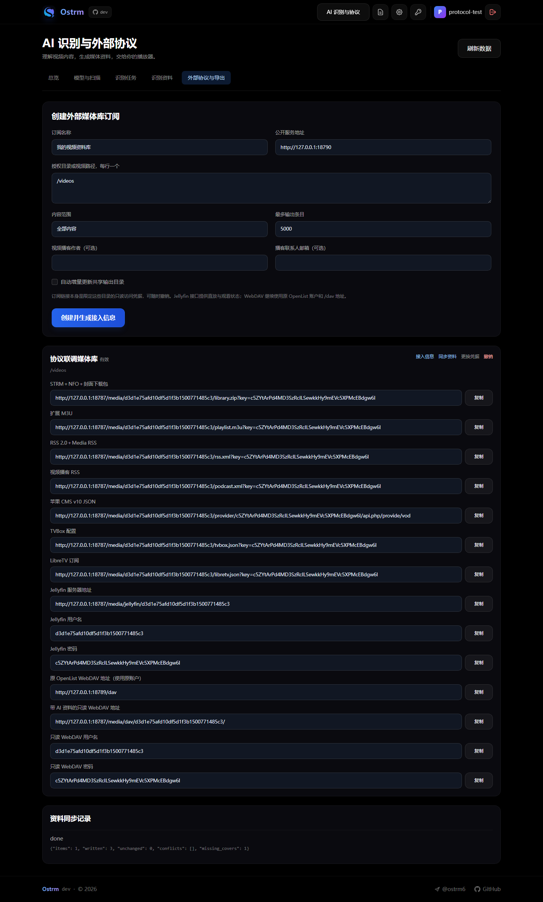

# OStrm AI：视频内容识别与外部媒体协议

基于 [hienao/ostrm](https://github.com/hienao/ostrm) 的真实 Fork。在 OStrm 的 OpenList 扫描、STRM 生成和任务管理上，增加 MiniCPM-V 4.7 视频理解、中文简介与标签、封面和外部媒体协议。

**本项目不提供视频播放器。** 视频仍保存在 OpenList 挂载的存储中；你使用 Kodi、Jellyfin、Infuse、TVBox 等客户端观看。AI 服务负责生成和维护媒体资料，播放请求解析当前有效的 OpenList 地址后重定向，不代理或转码播放流。

当前开发分支：**dev**。请按下方命令克隆 dev；main 保留上游发布历史，不代表这些新功能已经进入正式版。原项目说明保存在 [UPSTREAM_README.md](docs/UPSTREAM_README.md)。

## 功能

- 在线 MiniCPM-V 4.7 1B / 35B-A3B；兼容的自托管推理服务也可使用。支持 Docker 或 FreeBSD 原生运行，**不安装本地模型、不要求 GPU**。
- 读取真实视频，将完整时间轴压缩为 MP4 后发送给模型；支持字幕证据、受限的补充证据帧、缓存与重新识别。不是只看文件名生成标签。
- 中文摘要、内容标签、画面文字、人物和关系观察。AI 推测人物不冒充真实演员署名；文件名年份有明确来源。
- 持久化扫描、暂停/恢复/取消/重试、重启恢复；人工标签与 AI 标签分开保存。
- 保留 OStrm 原有任务；可选新 STRM 自动加入 AI 队列，识别后将 NFO、海报与 JSON 写入共享输出目录。
- 按目录、标签、成人/非成人范围创建独立媒体订阅；可以撤销和轮换凭据。
- SQLite 开箱即用；支持独立 TiDB 库，模型密钥不进入媒体文件和播放器配置。

| 输出/接口 | 用途 | 当前实现 |
|---|---|---|
| STRM + Kodi NFO + JPG + AI JSON | Kodi/Jellyfin 本地扫描 | ZIP 下载、持久化导出队列、增量同步；可附已有字幕 |
| 扩展 M3U | 通用播放列表/IPTV | 标题、时长、分组、封面、动态播放地址 |
| RSS 2.0 + Media RSS | 视频订阅 | enclosure、中文简介、关键词、分类、封面 |
| 视频播客 RSS | 播客客户端 | iTunes 作者/邮箱/显式内容/封面字段；仅 MP4/M4V/MOV |
| 苹果 CMS v10 JSON + TVBox | 国内聚合客户端 | 分类、搜索、分页、详情、播放地址；不宣称完整 CMS 后台 |
| LibreTV v2 订阅 | 聚合前端 | VOD 源和 M3U 源配置 |
| WebDAV | Infuse/Kodi 网络目录 | 复用 OpenList `/dav`；另有附 AI NFO/海报的只读虚拟目录 |
| Jellyfin 10.11 API 兼容层 | 账户登录、浏览、直放、观看进度 | 支持核心 SDK 路径；不含完整 Jellyfin 服务端或转码 |

**兼容性边界：** SDK/接口测试通过不等于所有品牌客户端都经过实机测试。Infuse、Apple Podcasts、TVBox 物理设备仍需按实际版本验证；不支持客户端要求的服务器转码。LibreTV 默认限制私网源，应使用客户端可访问的公网 HTTPS 地址。播客平台是否收录还取决于媒体编码、公网访问和平台审核要求。

## 实际界面

以下来自自动化测试启动的真实 Nuxt + Java + Python 服务，使用合成视频与固定模型响应，不作为模型准确率展示。截图中的地址和凭据仅用于本地测试。



<details><summary>移动端界面</summary>


</details>

## 安装：完整 OStrm AI

FreeBSD / Serv00 无 Docker 环境见 [原生安装、同域名路由与旧插件迁移](docs/FREEBSD_NATIVE.md)。完整 Java + Nuxt + Python 应用可以放在现有 OpenList 同域名的 `/ostrm/`，旧 `/media/` 订阅链接可保持不变。

需要网页影院时，可选用[原版 LibreTV 接入](integrations/libretv/README.md)，直接接入本项目的成人/非成人 CMS 源。影院作为独立进程运行，AI 服务继续专注识别与媒体资料。

适合 Linux NAS/VPS，安装 Docker Engine 与 Compose 插件即可。先有一个能够正常访问视频的 OpenList。

```bash
git clone --branch dev https://github.com/imHansiy/ostrm-ai.git
cd ostrm-ai
cp .env.ai.example .env
```

编辑 `.env`，至少设置：

```dotenv
OPENLIST_URL=http://你的OpenList:5244
PUBLIC_OPENLIST_URL=https://你的OpenList域名
OPENLIST_USERNAME=admin
OPENLIST_PASSWORD=你的OpenList管理密码
MODEL_BASE_URL=https://api.modelbest.ai/v1
MODEL_NAME=MiniCPM-V-4.7-35B-A3B
MODEL_API_KEY=你的对应区域模型密钥
JWT_SECRET=替换为至少32字节随机值
AI_BRIDGE_KEY=另一个独立随机值
MEDIA_PUBLIC_BASE_URL=https://你的OStrm-AI域名
AI_AUTO_ENQUEUE=false
```

可以使用 `openssl rand -hex 32` 分别生成两个随机值。国内密钥使用对应的国内端点；先确认部署主机能连接该区域服务。模型规格和地址也可以在 UI 中修改；模型密钥是只写字段。

容器中的 `localhost` 指向容器自身。OpenList 在宿主机时，请使用可路由地址或配置 Docker 的 host-gateway；不要将 `OPENLIST_URL` 填为客户端专用的不可达地址。

```bash
docker compose -f compose.ai.yml up -d --build
docker compose -f compose.ai.yml logs --tail=100 app ai
```

打开 `http://服务器:3111`，首次创建 OStrm 管理账户，然后进入顶部 **AI 识别与协议**。请在首次启动时立即完成注册；对外开放前配置 HTTPS。完整构建需要下载 Java/Node/Python 依赖，初次构建较慢。

AI 容器不暴露独立公网端口；OStrm 使用 JWT 登录并经服务器桥接访问 AI 管理接口。`AI_BRIDGE_KEY` 只配置在服务端。反向代理将整个 OStrm 域名转发至 3111，保留 `/api/`、`/media/`、Authorization、Range、HEAD、PROPFIND。

默认输出/数据目录：

| 宿主机 | 内容 |
|---|---|
| `data/config`、`data/db`、`logs` | OStrm 配置、数据库和日志 |
| `data/ai` | AI SQLite、密钥、证据缓存、字幕、封面缓存 |
| `strm` | OStrm STRM、AI NFO、海报及订阅同步目录 |

启用 `AI_AUTO_ENQUEUE=true` 后，OStrm 文件处理流水线会登记视频并入队。Java 与 AI 容器必须共享同一个 STRM 输出卷，Compose 已配置。当前一个 AI 服务对应一个 OpenList 实例；来源不匹配会拒绝写入。

## 使用：识别并导入播放器

1. 在「模型与扫描」填写模型地址和规格、扫描目录、排除目录、并发和网络/压缩超时。保存密钥，执行连接测试。默认识别并发为 1。
2. 在「识别任务」扫描小目录。按需开启字幕证据；先检查一两个视频的真实结果，再扫描整个挂载。
3. 在「识别资料」搜索简介/标签、查看结果、人工修改标签，或者重新识别。修改不会重命名或更改原视频。
4. 在「外部协议与导出」创建订阅。公开服务地址填写**播放器能连接到的 OStrm AI 地址**；授权目录可精确到单个视频。成人/非成人分类依赖已有识别标签，不是独立的人工审核结论。
5. 复制所需协议链接。播放时服务重新解析网盘地址，避免把一次性直链写死在 STRM 中。不要将管理员 Token 或模型密钥填写给播放器。

### Kodi / 真正的 Jellyfin 服务端

下载 STRM/NFO/封面 ZIP，解压到媒体库目录；或者点击「同步资料」，将共享 `strm/<订阅ID>/` 挂载给媒体服务器。开启自动同步后，每分钟检查更新。NFO 的简介和内容标签来自 AI，既有外部 NFO 的标题、演员和原简介会保留，AI 内容附加保存。被手工更改的受管理文件会报告冲突，不盲目覆盖。

在 Kodi 添加影片源并选择本地资料；Jellyfin 添加电影媒体库，启用本地 NFO/图片读取后扫描。`SxxExx` 命名会输出剧集 NFO，但不会自动猜测整季结构或合并多集为虚构剧目。AI 结构化人物关系保存在 `.ai.json`，不会当作真人演员写进 NFO。

### M3U / RSS / TVBox / LibreTV

把各自链接填入客户端的播放列表/订阅/配置地址。TVBox 配置提供 type=1 CMS 源；「成人 / 非成人分源」链接会在同一配置中生成两个独立来源，分类、搜索和详情均按内容类型过滤。CMS 支持 `ac`、`wd`、`t`、`pg`、`ids`、`limit`。不支持的复杂筛选不向客户端宣称可用。

播客订阅需要填写作者和联系人邮箱，并先生成封面；封面输出 1400×1400。原视频需要客户端支持的编码，源站需要支持 HEAD、Range 和公网访问；应用不会为了播放器转码原视频。

### WebDAV / Infuse

两种选择：原 OpenList `/dav` 使用原账户；「带 AI 资料的只读 WebDAV」使用本订阅给出的地址、用户名和密码。后者在每个视频目录中提供原视频、NFO、海报和已提取字幕，支持 Depth 0/1；禁止写入和无限深度枚举。原 OpenList WebDAV 不被替换。

### Jellyfin 兼容接入

在支持自定义服务器地址的客户端中填写「Jellyfin 服务器地址」及该订阅的用户名/密码。登录后可浏览简介、标签和封面，获得直放信息，并保存观看进度/收藏/已看状态。不同订阅状态相互隔离，重启后仍保留。

这是有限范围的直放接口，**不是 Jellyfin 二进制替代品**；需要服务器转码、插件、完整电视剧聚合或设备遥控时，请使用真正的 Jellyfin 服务端，再导入上面的 STRM/NFO。

## 没有 Docker / Serv00 等受限主机

Docker 是一种打包方式，不是推理要求。可只运行 Python 伴随服务，继续使用原 OpenList 的登录与管理页面：

```bash
cd ai-service
python3 -m venv .venv
. .venv/bin/activate
pip install '.[tidb]'
cp .env.example .env
# 编辑 OpenList、模型、AI_DATA_DIR、MEDIA_EXPORT_DIR、MEDIA_PUBLIC_BASE_URL 等
uvicorn aitags.app:app --host 127.0.0.1 --port 8787 --workers 1 --no-access-log
```

系统必须已有 FFmpeg/FFprobe；字幕 OCR 可选 Tesseract + chi_sim。没有 root 时使用可信的用户目录二进制并配置 `FFMPEG_BIN`/`FFPROBE_BIN`。仅一个 Worker 进程，不要运行多副本共同领取同一个队列。

将 `/ai/` 和 `/media/` 反代至 8787，原 OpenList 其他路径照旧。OpenList 自定义 head 添加：

```html
<script defer src="/ai/assets/ai.js"></script>
```

打开 `/ai/exports` 管理导出，或 `/@manage?ai=video-tags&view=settings` 管理识别。旧 `/ai/cinema` 会跳转到资料导出页；不再提供旧影视播放器。可选 `AI_PROXY_ENABLED=true` 用于单端口反代原 OpenList，但生产优先使用现有 nginx/Caddy。需要完整 OStrm Java/Nuxt UI 时，另在具有 Java21/容器条件的主机安装完整版本。

详细协议、升级、备份与排错见 [AI_PROTOCOLS.md](docs/AI_PROTOCOLS.md)。

## 测试与维护

```bash
pip install -e './ai-service[test,tidb]'
python -m pytest ai-service/tests -q
cd backend
./gradlew test spotlessCheck bootJar --no-daemon --no-configuration-cache
cd ../frontend
npm ci && npm run generate
cd ..
python tests/integration/run_local.py --keep
# 另一个终端
cd tests/clients
npm ci && npx playwright install chromium
npm run sdk
# 另起 tests/integration/ui_gateway.py 后
npm run ui
```

Java 需要 21。Windows 下若中文路径导致 Gradle 类路径异常，可 `subst O: 当前仓库绝对路径` 后在 `O:\backend` 执行；测试通过后移除映射。集成测试生成真实合成 MP4、实际压缩并发送视频内容到固定响应的模型接口，验证 Java JWT、队列、协议、HTTP Range 和 FFmpeg 解码；它不衡量模型准确率。GitHub Actions 另构建 AI 镜像、验证生产 Caddy 配置，并启动真正的 Jellyfin 导入 STRM/NFO/海报。

测试结果和未验证范围见 [实际验证记录](docs/VALIDATION.md)。所有日常修改在 dev；发布必须 dev → beta → main。

## 致谢与许可证

完整应用沿用上游 GPL-3.0-or-later（见 [LICENSE](LICENSE)）；独立 Python AI 服务保留原 MIT 声明（[ai-service/LICENSE](ai-service/LICENSE)）。感谢 OStrm、OpenList、OpenBMB MiniCPM-V 及各协议维护者。Fork 不代表上游对新增功能或客户端兼容性背书。
