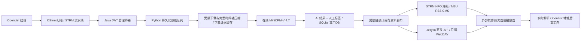

# 协议、运维与兼容性

## 数据流与模块



模型提示词位于 `ai-service/aitags/model.py`；视频压缩在 `media.py`；字幕提取在 `subtitles.py`。不是数据库中的写死标签。电影关系识别可能有误，应在批量识别前检查结果；已识别的正式片名/演职员资料与画面观察是不同来源。

`ai-service/aitags/protocols/` 是协议模块：store 保存订阅和观看状态，catalog 统一授权/ID/资料视图，formats 生成格式，publisher 管理本地资料和导出队列，router/Jellyfin/WebDAV 提供接口。Java `AiMetadataHandler` 在生成 STRM 后登记共享输出路径；AI 故障跳过该步骤，不破坏原 STRM 任务。

## 资源与性能

- 默认并发 1，最多 4。工作线程限制独立于播放器，协议播放只重定向，不运行播放转码。
- 单视频读取受 max_video_bytes、max_network_bytes、media_timeout 和本地工作空间上限约束。完整时间轴压缩仍然需要读取源视频；不承诺任意大文件零流量。
- 完整压缩视频目标约 23 MiB，模型服务的 HTTP 限额、视频帧采样和上下文限制仍取决于供应商；补充证据帧不是完整视频的替代品。
- Evidence cache 默认 64 MiB/24 小时，可通过 EVIDENCE_CACHE_MAX_BYTES / EVIDENCE_CACHE_TTL 调整。
- 协议目录只包含完成识别且在订阅范围内的视频，默认最多 5000，最高 50000；只读结果缓存 10 秒，撤销凭据每次都实时验证。
- MEDIA_EXPORT_MAX_BYTES 默认 256 MiB，限制单次资料同步和 ZIP；文件是资料，不包含原视频。不同订阅会分别占用输出目录，定期清理不再使用的订阅目录。
- 自动同步约每分钟检查一次。写入使用原子替换和哈希清单，遇到人工改动报告 conflicts；不会删除用户文件，也不会自动回收旧订阅文件。
- 撤销只阻止继续向服务请求。已经下载的 NFO/简介不会被远程删除，已经领取的网盘直链可能持续有效到源站过期。

## TiDB 与备份

AI_DB_BACKEND=tidb 时配置 AI_TIDB_HOST、PORT、USER、PASSWORD、DATABASE（默认 openlist_ai）。可复用 OpenList 的 TiDB 实例，但使用独立数据库。TLS 验证保持启用，不修改 OpenList 自身的表。TiDB 账号需要该数据库的建表权限；首次创建数据库可执行：

```bash
python -m aitags.migrate_tidb --init-only
```

SQLite 迁入 TiDB：先让当前识别完成，停止服务，备份整个 AI_DATA_DIR；设置 TiDB 环境变量后执行：

```bash
python -m aitags.migrate_tidb --source /原数据目录/aitags.sqlite3
```

目标库必须为空，工具逐表比较所有行，输出数量；包含队列游标、协议 ID、订阅、观看状态和导出任务。保留原 `media-secret.key`，否则旧订阅凭据无法重建。`media_export_jobs` 中运行中的导出在单 Worker 启动后重新排队；原 AI 队列按既有恢复规则继续。

备份途径：管理员 `POST /ai/api/backup` 返回 SQLite 快照（包括协议表）；`POST /ai/api/exports/backup` 返回数据库 + media-secret.key 的 ZIP。后者含可恢复订阅的秘密，应作为私密备份保存。当前 OStrm Java 桥接只开放 JSON 管理接口；二进制备份使用 Python 服务回环地址和原 OpenList 管理认证。模型密钥单独保存在 model-secret.json 或环境变量，不在数据库备份中。

完整灾备还需备份 AI_DATA_DIR（TiDB 封面 JPEG 在本地 cover-cache.sqlite3）、输出目录、OStrm config/db 和私密 .env。恢复时停止服务，校验备份，替换同一版本文件，设置权限 0600，再启动。TiDB 从 SQLite 灾备恢复同样通过 migrate_tidb 导入空库。

升级：备份后在 dev 拉取，重新构建并 `docker compose -f compose.ai.yml up -d --build`。只更换服务代码，不重建数据卷。卸载用 `docker compose -f compose.ai.yml down`，不要加 `-v`；确认不再需要后自行删除插件数据和生成资料。OpenList 视频和自身数据库不受影响。

## 安全边界

- 管理界面是现有 OStrm 单管理员账户，不提供新的多租户权限体系。
- 伴随模式复用 OpenList 管理账户；普通文件列表资料接口仍执行原文件权限检查。
- 管理员创建的订阅是主动授权其目录内容。每个订阅使用独立可撤销只读凭据，客户端无需管理员账户；订阅链接本身应保密。
- 所有协议使用相同根目录边界和内容过滤。Jellyfin 登录会话只访问其所属订阅；撤销/轮换后立即失效。
- 播放请求检查原文件指纹，修改后返回 409，要求重新识别。外部媒体主机须在 MEDIA_ALLOWED_HOSTS 中，或与 OpenList 同源。允许主机不是开放代理许可，私网跳转仍受限制。
- 服务单进程队列锁避免同一数据目录的重复 Worker。不要多副本共享单数据库运行后台队列。
- 默认 Caddy 日志移除请求 URI 和认证头，避免订阅密钥被记录；额外 nginx/Cloudflare/第三方客户端日志也应自行配置脱敏。

## 排错

### 历史失败的分批恢复

修复网盘连接、允许的媒体主机和资源配置后，可在 AI 服务的工作目录执行以下命令。原生安装先激活 Python 环境；Docker 使用 `docker compose -f compose.ai.yml exec ai python -m aitags.recovery ...`。

```sh
python -m aitags.recovery start --batch-size 20 --directory-batch-size 3 --rounds 2 --interval 30
python -m aitags.recovery status
python -m aitags.recovery pause
python -m aitags.recovery resume
python -m aitags.recovery stop
```

某个挂载的下载网络或授权尚未恢复时，可在创建计划时加 `--exclude-root /网盘/暂不可用的挂载`（可重复传入）。该范围的视频和目录只延后，不删除失败记录，也不会改变 OpenList 挂载配置；恢复摘要显示延后数量。修复外部条件后，停止已结束/旧计划并重新创建不带该排除项的计划即可重试。

恢复计划保存在现有 AI 数据库中，重启后继续，只有单个后台 Worker 投放批次。每批最多重新入队 20 个已有失败视频和 3 个失败目录；本批与目录中新发现的任务处理完后再投放下一批。目录保留原分页游标；正常增量扫描继续跳过未变化的成功视频。旧任务失败、但视频已在后续识别成功的情况，也不会重复入队。暂停或取消的扫描不会被恢复计划擅自重新开启。

默认最多两轮，第二轮至少间隔五分钟，已确定为损坏、已删除、认证/下载权限或大小预算不足的文件不在第二轮反复尝试。`pause`/`stop` 停止投放后续批次，已入队任务可在原任务管理中暂停/取消。`/ai/api/overview` 的 `recovery` 返回恢复摘要，完整 ID 游标不会混入模型设置。任务历史记录读取、整片压缩和调用模型的阶段，便于区分慢任务与空队列。

背景 OpenList 读请求使用 `OPENLIST_SCAN_TIMEOUT`（默认 60 秒），临时错误最多追加两次重试；四秒目录可用性探测不会被延长。模型仅对明确的 408/429/5xx 临时拒绝做有限重试，不自动重复认证错误、HTTP 409 或结果不明的超时请求。媒体下载错误保留源站 HTTP 状态、预算或网络原因，不再一律报 FFmpeg 解码失败。

白名单必须按实际可信存储配置，例如百度 `*.baidupcs.com`、PikPak `*.mypikpak.net`；不要使用任意主机 `*`。每次重定向仍检查白名单和公网地址。百度媒体请求使用其驱动要求的 `User-Agent: pan.baidu.com`。文件真的损坏、删除、网盘授权过期或服务商无法访问时，恢复计划保留失败原因，不会伪造成功。

| 现象 | 检查 |
|---|---|
| AI 中心 503 | 两个服务的 AI_BRIDGE_KEY 一致；AI_SERVICE_URL 从 Java 可达 |
| 模型 401 | 国内/海外密钥区域和端点是否一致，不只看模型名称 |
| 模型 413 | 服务商请求体限额；完整 MP4 的 base64 会额外放大约三分之一 |
| 扫描完成但没有结果 | 识别任务失败原因、目录权限、扩展名和排除目录；API 只导出 done |
| 播放 409 | 源文件大小/修改时间/哈希已变化，重新扫描识别 |
| 播放 502 | OpenList 直链是否可用，主机白名单、HTTPS 和外部客户端网络 |
| 无封面 | 在原管理设置启用补齐封面；确认 FFmpeg 可读视频；源目录不可写时仍保留私有缓存 |
| 资料输出 conflicts | 生成文件被手工改过，或外部 NFO 格式错误；保护现有文件后人工处理 |
| Jellyfin 客户端要求转码 | 使用真实 Jellyfin 服务端导入 STRM/NFO；兼容层只支持直放 |
| LibreTV 提示私网源 | 配置外部可访问的 HTTPS 服务地址，其默认策略限制 LAN 源 |
| 重启后订阅失效 | media-secret.key 未与数据库一起恢复、已轮换/撤销、公开地址变化 |
| Caddy 配置校验失败 | 使用 Caddy 2；保留 /media 不经过 SPA rewrite；检查挂载文件是否正确 |

## 验证范围

最新交付结果与真实 TiDB/在线模型数据见 [VALIDATION.md](VALIDATION.md)。

本地验证包含 Python API/扫描/媒体/权限/协议测试、Java 测试和 Spotless、Nuxt 生产生成、真实 Java 登录桥接与 Python Worker、实际 FFmpeg 压缩与解码、HTTP Range、官方 @jellyfin/sdk 0.13、桌面和 390px 移动端页面操作及溢出检查。集成模型使用固定响应，不向 CI 注入任何真实密钥。

CI 工作流 `.github/workflows/ai-protocols.yml` 在 dev push 时执行，另检查 AI Docker 镜像、Caddy 和真实 Jellyfin 10.11 NFO/海报导入。**具体最新通过状态以 GitHub Actions 为准**，不能将定义了测试等同于已经通过。物理 Infuse/Kodi/TVBox/Apple 客户端和各种网盘视频编码组合未穷尽验证。

## 协议依据

- [Kodi STRM](https://kodi.wiki/view/Strm)、[Kodi Movie NFO](https://kodi.wiki/view/NFO_files/Movies)
- [RSS 2.0](https://www.rssboard.org/rss-specification)、[Media RSS](https://www.rssboard.org/media-rss)
- [Apple Podcasts requirements](https://podcasters.apple.com/support/823-podcast-requirements)
- [LibreTV 数据源格式](https://libretv.is-an.org/wiki/Data-Sources.html)
- [Infuse 网络共享](https://support.firecore.com/hc/en-us/articles/215090977-Streaming-From-a-Mac-PC-or-NAS)
- [Jellyfin SDK](https://typescript-sdk.jellyfin.org/index.html)、[Jellyfin NFO](https://jellyfin.org/docs/general/server/metadata/nfo/)
- [MiniCPM-V 官方项目](https://github.com/OpenBMB/MiniCPM-V)
